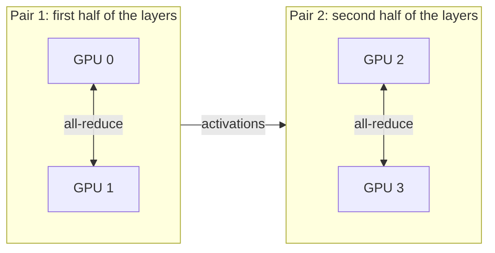

# Castagna Veloce: the AMD Instinct MI50 inference engine

<p align="center">
  
</p>

Castagna Veloce is an inference engine for one GPU: the AMD Instinct MI50 (Vega 20,
`gfx906`), with 32 GB of HBM2 per card. It runs current large models across 2 to 8
cards: the DeepSeek V4 and V4.1 Flash, GLM-5.3-Flash and Qwen3.8 Flash-Next mixtures
of experts, and the dense Qwen3.8 27B. The cards are joined by tensor parallelism over
plain PCIe, and speculative decoding (MTP, DSpark) makes single-user generation fast.

It is a fork of [llama.cpp](https://github.com/ggml-org/llama.cpp). It uses the same
GGUF weights and the same `llama-server` with its OpenAI-compatible API and Web UI. On
top of that it adds gfx906 kernels, fused operations for MoE-era architectures, and
multi-GPU plumbing for cards without matrix cores or fast interconnects.

Issues and contributions are welcome, especially from other MI50 and MI60 owners.

## Models

| Model | Cards | Weights and drafter | Guide |
| --- | --- | --- | --- |
| Qwen3.8 Flash-Next | 4 | Unsloth UD-Q4_K_XL, MTP, vision | [qwen3.8-flash-next.md](docs/models/qwen3.8-flash-next.md) |

The guide has the pinned download command, the serve commands for both serving profiles
with every setting explained, and the model's known caveats.

The engine also runs DeepSeek V4 and V4.1 Flash, GLM-5.3-Flash and the dense Qwen3.8 27B;
this documentation covers Qwen3.8 Flash-Next.

## What is different from upstream llama.cpp

Everything below was written for the MI50, and none of it is in upstream llama.cpp.
Nearly every optimization has a runtime switch, usually a `GGML_CUDA_*` environment
variable, so it can be turned off for A/B tests and bug reports.

**Kernels for the MI50** (in `ggml/src/ggml-cuda/`, built with HIP):

- i-quant MoE decode kernels for the IQ2_XXS, IQ2_XS, IQ3_XXS and IQ4_XS experts, for
  batches of up to 64 tokens, and an expert-grouped quantized MoE GEMM for prefill.
- Small-batch matvecs for K-quants (q4_K, q5_K, q6_K, iq4_xs), Q8_0 (with a split-K
  variant), F16 and F32, for 1 to 16 tokens. They are sized for speculative-decoding
  verify batches.
- Flash attention written for GCN: dense, sparse (DeepSeek V4's compressed layers) and
  QSA variants, plus a 64-head lightning indexer for DeepSeek V4's verify and prefill
  batches.
- `DSV4_COMP_POOL`, an op that runs DeepSeek V4's compressor gather, pooling and norm
  as one kernel.
- Split-K F16/F32 GEMMs for few-row, long-K prefill shapes, and grids reordered for
  memory channels in MoE reduction and HC mixing.

**Fused operations:**

- The hyper-connection step in one kernel: HC post, mix, pre, RMS norm and scale.
- Router and top-k in one kernel: matvec, gating, top-k and weight normalization.
- Gate/up + SwiGLU, matvec + residual add, broadcast gate and small-concat kernels
  for verify batches.
- KDA gated-norm fusion, Q8 activations reused across weight types, and batched sibling
  matvecs.
- DeepSeek V4 state-row, position-embedding and multi-matrix fusions, which cut kernel
  launches per token from about 4,400 to about 1,200.

**Multiple cards:**

- Tensor-parallel pairs: tensor parallelism inside pairs of cards, with the layers
  pipelined across the pairs (see below).
- A PCIe all-reduce for both layouts: pairs write straight into the peer card's
  memory; groups of four use kernel peer writes for decode-sized tensors and
  copy-engine DMA for prefill-sized ones.
- Persistent hyper-connection and MoE kernels with each pair's all-reduce fused in.
- A split output head for DeepSeek V4, with a mirrored copy for the DSpark drafter.
- Several virtual devices per card, for pipelined layer-split prefill.

**Speculative decoding and serving:**

- DSpark for DeepSeek V4 Flash: a converter from antirez's DSpark GGUF to llama.cpp's
  DFlash draft format, plus the KV-cache and crash fixes that made it run.
- MTP drafter graph reuse, and catch-up merged into the draft step.
- A verify-shaped last prompt chunk (`LLAMA_CKPT_LAST_VERIFY`): one graph rebuild
  fewer per request, and a faster first token.
- A draft vocabulary prefix (`LLAMA_MTP_DRAFT_VOCAB`): the drafter scores only the
  first 96K token ids, split across the cards, while the target still checks every
  draft against the full vocabulary. This is the idea of
  [FR-Spec](https://arxiv.org/abs/2502.14856) applied to an MTP head.

**Accuracy:**

- F32-accumulating vision encoders for GLM-5.3, Qwen3.8 and DeepSeek V4.1. This
  costs some encode time, not speed elsewhere.

## Tensor-parallel pairs

Castagna Veloce can run tensor parallelism in **pairs** of cards. Each pair splits
every matrix of its layers across its two cards, the layers are divided between the
pairs, and the pairs run as a pipeline. Qwen3.8 Flash-Next's decode profile uses this
layout on 4 cards, while DeepSeek V4, GLM-5.3 and DeepSeek V4.1 run as groups of four.
Upstream llama.cpp's `-sm tensor` always puts all cards into one group.



Why pairs suit the MI50:

- **Point-to-point exchanges.** These cards have no fast links between them, so every
  tensor-parallel all-reduce crosses PCIe. Inside a pair, each card exchanges with one
  peer only. A group of four needs an all-to-all exchange in which every card sends to
  three others over shared PCIe lanes.
- **Direct writes into the peer's memory.** The MI50 exposes all of its VRAM over PCIe
  (a 32 GB BAR). Each card pushes its partial result into an inbox on the other card
  and raises a flag there, then waits on its own local memory. That is one PCIe
  crossing per value instead of a round trip through host memory. Cards without peer
  access fall back to staging through host memory automatically.
- **The pairs overlap.** Reductions are queued deep on the GPUs, so the host can
  submit a whole step ahead and both pairs work at the same time instead of taking
  turns.
- **Fused into the layer.** In Qwen3.8 Flash-Next's decode profile, each pair's
  all-reduce runs inside persistent kernels that also do the model's hyper-connection
  and MoE steps. Both cards add the partial results in the same order, so their copies
  stay bit-identical.

Choosing the layout:

| `LLAMA_TP_GROUP` | Layout | Used by |
| --- | --- | --- |
| `2` | pairs: 2 + 2 on 4 cards, 2 + 2 + 2 + 2 on 8 | Qwen3.8 Flash-Next, decode profile |
| `4` | groups of four: one group on 4 cards, two on 8 | DeepSeek V4, GLM-5.3, DeepSeek V4.1 |
| `0` | one group over all cards, as in upstream llama.cpp | |

Left unset with `-sm tensor` on 4 or more cards, it also gives pairs, so the model
guides always set it. `LLAMA_TP_LAYER_SPLIT=a,b,...` sets the share of layers each
group gets; by default it follows each group's free memory.

## Quality

Every change is checked before it is kept:

- **Kernels and fusions:** each one has a `test-backend-ops` case that compares it
  with the CPU backend. The fused paths are confirmed to actually run in the real
  model graph, with `GGML_CUDA_OP_PROFILE`.
- **Perplexity:** every model's perplexity on a fixed text is re-checked after each
  change, at the batch sizes the change affects. For example, ubatch 2 or 3 covers
  the MTP verify batches.
  - Changes meant to be exact must stay bit-identical.
  - Changes that alter rounding are compared with the noise floor of other rounding
    changes, and judged over many prompts, not one.
- **Stability:** a stress run (long generations and multi-turn chats with prompt-cache
  reuse) before deploying.

## Quickstart

### 1. Build

Supported setup: Ubuntu 26.04 LTS with its own ROCm 7.1 packages, which still ship
`gfx906` code. Kernel 7.0, HIP 7.1, LLVM/Clang 21.

```sh
sudo apt install build-essential cmake git hipcc libamdhip64-dev libhipblas-dev librocblas-dev \
  rocm-device-libs-21 rocminfo rocm-smi
git clone https://github.com/benpeterson40/castagna-veloce
cd castagna-veloce
cmake -S . -B build -DGGML_HIP=ON -DAMDGPU_TARGETS=gfx906 -DGPU_TARGETS=gfx906 \
  -DCMAKE_BUILD_TYPE=Release -DGGML_HIP_NO_VMM=ON -DGGML_HIP_GRAPHS=ON -DGGML_CUDA_FA=ON \
  -DGGML_SCHED_MAX_COPIES=8 -DLLAMA_CURL=OFF
cmake --build build -j --target llama-server llama-cli llama-bench llama-perplexity
rocminfo | grep -c gfx906   # one line per card
```

Your user needs access to `/dev/kfd` and `/dev/dri/renderD*`, usually through the
`render` and `video` groups. Log out and back in after changing membership. If CMake
picks the wrong compiler, pass `-DCMAKE_HIP_COMPILER=/usr/lib/llvm-21/bin/clang++`.

### 2. Download a model

Qwen3.8 Flash-Next at 4 bits (about 114 GB, 4 cards):

```sh
pip install -U huggingface_hub   # provides the hf command
hf download unsloth/Qwen3.8-Flash-Next-GGUF --revision 38bb39ee97821de2c9009abb7e93950eec396e66 \
  --include "UD-Q4_K_XL/*" "MTP/mtp-Qwen3.8-Flash-Next-shared-Q8_0.gguf" "mmproj-F16.gguf" \
  --local-dir models/Qwen3.8-Flash-Next-GGUF
```

### 3. Serve

The decode profile: the 4 cards run as two tensor-parallel pairs, with persistent
kernels for the hyper-connection and MoE steps.

```sh
HIP_VISIBLE_DEVICES=0,1,2,3 LLAMA_TP_GROUP=2 \
GGML_CUDA_VIRTUAL_PER_GPU=1 GGML_CUDA_HC_PERSIST=4 GGML_CUDA_HCP_AR=1 GGML_CUDA_HCP_INJ=1 \
GGML_CUDA_DISABLE_GRAPHS=1 LLAMA_MTP_DRAFT_VOCAB=98304 LLAMA_CKPT_LAST_VERIFY=1 \
./build/bin/llama-server \
  -m models/Qwen3.8-Flash-Next-GGUF/UD-Q4_K_XL/Qwen3.8-Flash-Next-UD-Q4_K_XL-00001-of-00004.gguf \
  -ngl 999 -fa on -sm tensor -b 2048 -ub 320 -c 32768 --jinja -np 1 \
  -md models/Qwen3.8-Flash-Next-GGUF/MTP/mtp-Qwen3.8-Flash-Next-shared-Q8_0.gguf \
  --spec-type draft-mtp --spec-draft-n-max 3 --spec-draft-ngl 999 \
  --host 0.0.0.0 --port 8080
```

Then, from another terminal, ask it something through the OpenAI-compatible API:

```sh
curl http://localhost:8080/v1/chat/completions \
  -H "Content-Type: application/json" \
  -d '{"messages": [{"role": "user", "content": "Say something"}]}'
```

`LLAMA_TP_GROUP=2` makes the 4 cards two tensor-parallel pairs, and `--spec-type
draft-mtp` turns on the model's MTP drafter. The
[Qwen3.8 Flash-Next guide](docs/models/qwen3.8-flash-next.md) explains every setting,
including the prefill profile for long prompts.

The Web UI is at `http://localhost:8080`. For Open WebUI, the OpenAI SDK and similar
clients, set the base URL to `http://localhost:8080/v1`.

## Usage notes

- **Qwen3.8 Flash-Next thinks by default.** Use
  `"chat_template_kwargs": {"enable_thinking": false}` for direct answers.
- **Images:** add `--mmproj` with the model's projector file (see its guide). The
  encoder runs on the first card, and a very large photo can need over a gigabyte
  there, so cap images with `--image-max-tokens 2048`.
- **One user per server** (`-np 1`) is the tuned configuration. The kernels for 1-6
  token batches are what make speculative decoding fast.

## Hardware notes

- **Cards:** tested on MI50 32 GB (VBIOS 113-D1631700-111). The MI60 is the same
  `gfx906` chip and should work, but it is untested. The 16 GB MI50 needs more cards
  for the same models.
- **Peer access:** the fastest pair all-reduce writes directly into the other card's
  VRAM, which needs the full 32 GB BAR. Our cards have it; on cards without peer
  access the engine stages the exchange through host memory instead.
- **PCIe slots matter for prefill.** The tensor-parallel all-reduce moves several MB
  per layer during prefill. On our board only 3 of 8 slots are x16; a 2-card model on
  two x16 cards prefills faster than on an x16 + x8 pair. Decode is barely affected.
- **Clocks:** fixing the cards at the high performance level
  (`echo high | sudo tee /sys/class/drm/card*/device/power_dpm_force_performance_level`)
  avoids clock ramps between drafting and verifying. The published configuration uses
  the default `auto` on all cards but the first.
- **Cooling:** the MI50 is passively cooled and needs real front-to-back airflow.

## License

Castagna Veloce is a fork of llama.cpp and keeps its [MIT license](LICENSE). The
MI50-specific changes are MIT licensed as well. Model weights are not included and
keep their publishers' licenses.

Castagna Veloce is not affiliated with or endorsed by AMD. AMD, Instinct and Radeon are
trademarks of Advanced Micro Devices, Inc.

## Acknowledgements

- [llama.cpp and ggml](https://github.com/ggml-org/llama.cpp), the base of everything
  here.
- [danielhanchen](https://github.com/ggml-org/llama.cpp/pull/28243) for the Qwen3.8
  Flash-Next MTP draft head, the branch this fork started from.
- [timkhronos](https://github.com/ggml-org/llama.cpp/pull/27773) for GLM-5.3-Flash
  support, ported here from an earlier revision.
- [smalinin/llama.cpp](https://github.com/smalinin/llama.cpp/tree/my_build_deepseek41)
  for DeepSeek V4.1 support, ported here from an earlier revision.
- [antirez](https://github.com/antirez/ds4) for the DeepSeek V4 Flash GGUFs and the
  DSpark drafter.
- [Unsloth](https://huggingface.co/unsloth) for the GLM-5.3-Flash and Qwen3.8 GGUFs,
  [vcruz305](https://huggingface.co/vcruz305/DeepSeek-V4.1-Flash-GGUF) for the
  DeepSeek V4.1 Flash GGUF, and
  [smalinin](https://huggingface.co/smalinin/DeepSeek-V4.1-Flash-GGUF) for its vision
  projector.
